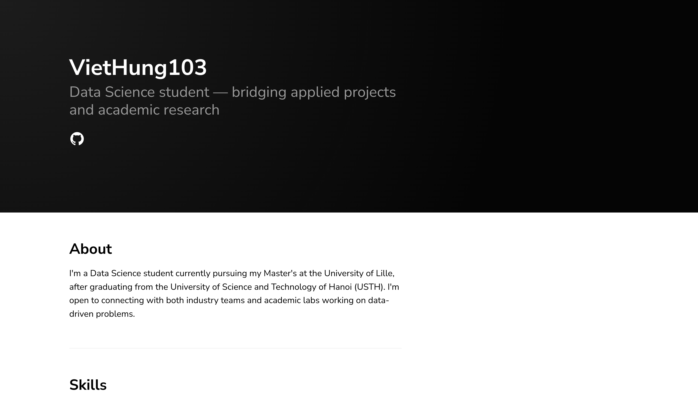

# VietHung103.github.io

Welcome to my personal website!

This website is built using a customized version of the [Texture Jekyll Theme](https://github.com/samarsault/texture-jekyll) and is hosted on GitHub Pages.

The main purpose of this website is to share my academic journey, projects, experiences, and achievements throughout my university studies. I will continue to update it with new experiences, especially during my Master's studies in Data Science.

**Visit my website:** [https://viethung103.github.io/](https://viethung103.github.io/)

## Website Preview

The image below shows a preview of my personal website.

## About This Website

This website includes information about:

- **About Me:** My background, education, and interests.
- **Projects:** Academic and personal projects I have worked on.
- **Experience:** My internships, research activities, and university experiences.
- **Achievements:** Important milestones throughout my academic journey.

The website will be regularly updated as I continue my studies and gain new experiences.

## Built With

- [Jekyll](https://jekyllrb.com/) – Static site generator
- [Texture Jekyll Theme](https://github.com/samarsault/texture-jekyll) – Original website theme
- [GitHub Pages](https://pages.github.com/) – Website hosting

## License

The original Texture Jekyll Theme is available as open source under the terms of the [MIT License](https://opensource.org/licenses/MIT).
